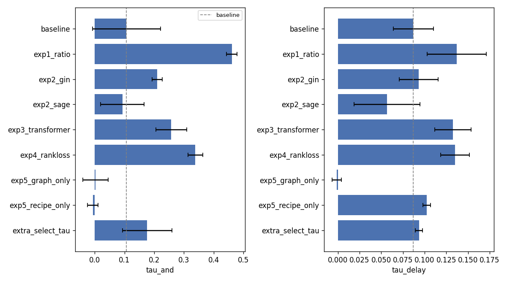
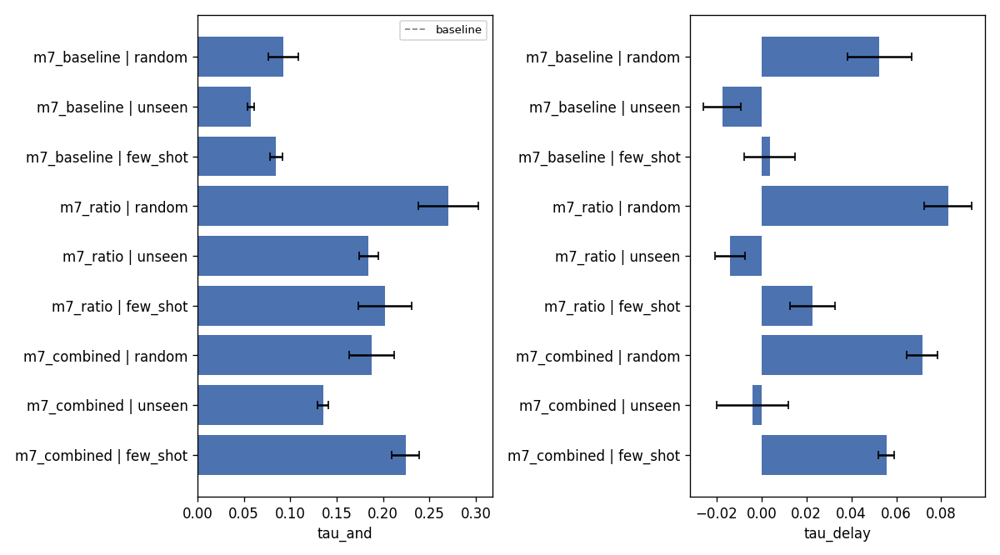

# NetSense-QoR

A graph neural network that predicts the quality of a digital circuit after logic synthesis (its
**AND-gate count**, a proxy for area, and its **delay**) from two inputs:

1. the circuit as an **And-Inverter Graph (AIG)**, and
2. a **synthesis recipe**: a sequence of 20 optimisation commands for the ABC tool
   (`refactor`, `rewrite`, `resub`, `balance` and their `-z` variants).

Running real synthesis for every candidate recipe is slow. A model that predicts the result in milliseconds
can **rank** many recipes, so only the most promising ones have to be run for real. For that reason the main
metric is **ranking quality** (Kendall's tau between predicted and true values across the recipes of one
design), not only the percentage error.

Trained and evaluated on the [OpenABC-D](https://github.com/NYU-MLDA/OpenABC) dataset (1,500 recipes per
design). Solo university deep learning project; the full plan is in [PRD.md](PRD.md).

## Results at a glance

1. **Ratio targets matter most.** Predicting *final ÷ initial* (e.g. final AND count ÷ initial AND count)
   instead of the raw value raised AND ranking (tau) from 0.11 to 0.46. It also made the model the first to
   beat a "guess the design's average" reference on AND error (0.72% vs 1.47%). No change to the
   architecture, loss or epoch selection did as much.
2. **AND ranking partly transfers to unseen circuits, delay does not.** On designs never seen in training,
   ratio models still rank recipes for AND (tau 0.18 vs 0.27 on seen designs). Delay ranking drops to about
   0, because delay ÷ initial depth differs more than 20-fold between designs.
3. **Twenty examples go a long way.** Fine-tuning on 20 synthesised recipes of a new design cuts its AND
   error from ~14–16% to ~1% and raises the best model's tau to 0.22.
4. **Low MAPE alone is misleading.** Almost all variation in AND count is *between* designs (99.7%), so a
   model can get a small percentage error just by knowing which design it is looking at. Every table therefore
   includes a recipe-ignoring reference guess and ranking metrics.

Full write-ups with per-design numbers and explanations: [docs/findings.md](docs/findings.md).

### Experiments (M6): one change at a time

4 designs (i2c, spi, fir, wb_dma), random split by recipe (designs seen in training), 3 seeds each, mean ± std.
Each variant changes one setting of the baseline (GCN graph encoder + 1D-CNN recipe encoder, raw targets, MSE).

| Variant | tau AND | tau delay | MAPE AND % | MAPE delay % |
|---|---|---|---|---|
| baseline | 0.107 ± 0.114 | 0.087 ± 0.023 | 2.07 ± 0.17 | 8.48 ± 0.19 |
| **ratio targets** | **0.461 ± 0.018** | **0.137 ± 0.034** | **0.72 ± 0.04** | 7.94 ± 0.22 |
| GIN graph encoder | 0.210 ± 0.018 | 0.093 ± 0.022 | 2.60 ± 0.79 | 8.19 ± 0.21 |
| GraphSAGE graph encoder | 0.093 ± 0.074 | 0.056 ± 0.038 | 3.11 ± 0.64 | 7.99 ± 0.25 |
| transformer recipe encoder | 0.257 ± 0.052 | 0.133 ± 0.021 | 2.40 ± 0.32 | 8.04 ± 0.37 |
| MSE + pairwise ranking loss | 0.338 ± 0.025 | 0.135 ± 0.016 | 5.47 ± 0.22 | 9.13 ± 0.42 |
| graph only (no recipe) | 0.003 ± 0.042 | -0.001 ± 0.006 | 2.07 ± 0.26 | 7.59 ± 0.10 |
| recipe only (no graph) | -0.006 ± 0.018 | 0.103 ± 0.004 | 66.91 ± 0.01 | 56.15 ± 0.09 |
| best epoch chosen by val tau | 0.176 ± 0.083 | 0.094 ± 0.004 | 6.24 ± 2.94 | 15.09 ± 8.84 |
| *reference: design's training average* | — | — | *1.47* | *7.42* |



### Generalisation (M7): seen designs, unseen designs, and few-shot

12 designs. *random* = recipes split at random (designs seen). *unseen* = by-design 4-fold split, each model
never sees its 3 test designs. *few-shot* = the unseen-design model fine-tuned on 20 recipes of the new design,
tested on its other 1,480 recipes (the same recipes as *unseen*). 3 seeds each.

| Variant | Setting | tau AND | tau delay | MAPE AND % | MAPE delay % |
|---|---|---|---|---|---|
| baseline (raw) | random | 0.093 ± 0.016 | 0.053 ± 0.014 | 3.00 ± 1.37 | 32.4 ± 4.3 |
| ratio | random | **0.271 ± 0.032** | **0.083 ± 0.011** | 0.98 ± 0.06 | 22.5 ± 2.0 |
| ratio + GIN + transformer | random | 0.188 ± 0.024 | 0.072 ± 0.007 | 0.99 ± 0.08 | 20.4 ± 5.7 |
| *reference: design's training average* | random | — | — | *0.92* | *11.2* |
| baseline (raw) | unseen | 0.057 ± 0.003 | -0.018 ± 0.008 | 174.6 ± 3.9 | 1056 ± 66 |
| ratio | unseen | **0.184 ± 0.010** | -0.014 ± 0.007 | 16.4 ± 0.2 | 304 ± 25 |
| ratio + GIN + transformer | unseen | 0.135 ± 0.006 | -0.004 ± 0.016 | 13.9 ± 0.3 | 198 ± 10 |
| *reference: average ratio of the training designs* | unseen | — | — | *10.8* | *128* |
| baseline (raw) | few-shot | 0.085 ± 0.007 | 0.004 ± 0.011 | 3.35 ± 0.33 | 33.7 ± 16.5 |
| ratio | few-shot | 0.202 ± 0.028 | 0.023 ± 0.010 | 1.07 ± 0.17 | 24.2 ± 1.9 |
| ratio + GIN + transformer | few-shot | **0.224 ± 0.015** | **0.056 ± 0.004** | **0.85 ± 0.03** | 17.5 ± 1.7 |
| *reference: average of the 20 shots* | few-shot | — | — | *0.96* | *10.9* |



**Limitations.** Delay is predicted poorly, especially on new designs; no model beats the simple reference
on delay error. Results use 4 or 12 small-to-medium designs and 3 seeds, so small differences are not
reliable. GPU training is not bit-for-bit reproducible, so re-runs give slightly different numbers.

## How it works

```
AIG (nodes = gates, edges = wires)              recipe: 20 command IDs
        |                                                |
3 message-passing layers (GCN / GIN / SAGE)     embedding per command
        |                                                |
mean pooling -> one vector per circuit          1D CNN or transformer over the 20 steps -> mean
        \______________________ concatenate ____________/
                                    |
                     2-layer MLP -> [AND count, delay]   (standardised; raw or ratio targets)
```

- **Node features** (6): one-hot node type (input / output / AND gate) and one-hot number of inverted inputs (0, 1, 2).
- **Targets:** `raw` (final value) or `ratio` (final value ÷ the initial graph's AND count or logic depth),
  standardised with training-set statistics only.
- **Metrics** (on real-unit values): MAPE; Kendall's tau per design, averaged over designs; top-10 overlap.
- **Splits:** random by recipe ID (unseen recipes), or by design (unseen circuits). Split files are saved in `splits/`.
- **Speed trick:** all 1,500 recipes of a design share one initial graph, so each batch encodes every distinct
  design graph once and reuses the vector for all of that design's samples.

## Repository layout

| Path | What it holds |
|---|---|
| `src/data.py` | Loading the OpenABC-D files (including the old PyG 1.7 format), splits, targets, Dataset and batching |
| `src/models.py` | Graph encoders, recipe encoders, full model |
| `src/train.py` | Training with early stopping, checkpoint, test evaluation, plots (`python -m src.train`) |
| `src/evaluate.py` | Metrics and the reference predictor |
| `src/run_experiments.py` | M6: several configs × seeds → results table |
| `src/run_generalisation.py` | M7: random / unseen designs / few-shot → results table |
| `src/make_subset.py` | Builds the compact 44-file copy of the data used on Kaggle |
| `configs/` | One YAML per experiment (`baseline.yaml`, `exp*.yaml`, `m7_*.yaml`) |
| `notebooks/` | Data exploration (01) and the Kaggle notebooks for the baseline (02), M6 (03) and M7 (04) |
| `results/` | Committed results: tables, plots, training logs and the executed Kaggle notebooks |
| `docs/` | `data_notes.md` (verified data format), `findings.md` (what each experiment showed), `data_sources.md` |
| `tests/` | `pytest` tests; those needing the dataset are skipped when it is missing |

## How to run

### 1. Setup

Python 3.11+ (developed on 3.14). Windows PowerShell:

```
python -m venv .venv
.venv\Scripts\activate
pip install torch --index-url https://download.pytorch.org/whl/cpu
pip install -r requirements.txt
```

Linux / macOS: the same, with `source .venv/bin/activate`. If you have a CUDA GPU, install the matching
PyTorch build from [pytorch.org](https://pytorch.org) instead of the CPU one.

### 2. Get the data

Download the **ML-ready** OpenABC-D dataset linked from the [OpenABC README](https://github.com/NYU-MLDA/OpenABC)
(~18 GB) and extract it, for example to `OPENABC2_DATASET/` in the project folder (it is gitignored). The code
needs:

```
OPENABC2_DATASET/
├── processed/<design>_syn<N>_step0.pt.zip   # 42 designs × 1500 recipes
└── synthesisStatistics.pickle               # labels
```

Optional: build a compact copy (44 files, ~80 MB) holding only what the code reads. It loads much faster and
is what the Kaggle notebooks use:

```
python -m src.make_subset --data-root OPENABC2_DATASET --out kaggle_data/openabc-compact
```

Every command below accepts either folder as `--data-root`.

### 3. Check everything works

```
pytest
```

Tests that need the dataset look in the config's `data.root` (`OPENABC2_DATASET`), or in the folder named by
the `NETSENSE_DATA_ROOT` environment variable; without data they are skipped.

### 4. Reproduce the baseline

```
python -m src.train --config configs/baseline.yaml --data-root OPENABC2_DATASET
```

This trains with early stopping (at most 100 epochs, about 3 s per epoch on a laptop CPU for the 4 baseline
designs) and writes `runs/baseline_<timestamp>/`:

- `metrics.csv`: one row per epoch
- `best.pt`: the best checkpoint
- `test_metrics.json`: MAPE, Kendall's tau and top-10 overlap
- `test_predictions.csv`
- `loss_curve.png` and `test_scatter.png`

Compare with [results/baseline/test_metrics.json](results/baseline/test_metrics.json): tau and MAPE should be
in a similar range, but not identical (see Limitations).

Add `--max-epochs 2` for a quick smoke test.

### 5. Run the experiments

```
python -m src.run_experiments --data-root OPENABC2_DATASET        # M6: 9 configs × 3 seeds -> results/experiments/
python -m src.run_generalisation --data-root OPENABC2_DATASET     # M7: 45 runs + few-shot -> results/generalisation/
```

On a free Kaggle T4 GPU these took about 1 hour (M6) and about 3 hours (M7). They are slow on a CPU.

### Running on Kaggle

1. Build the compact copy (step 2) and upload `kaggle_data/openabc-compact` as a private Kaggle dataset.
2. Import one of `notebooks/02_kaggle_train.ipynb` (baseline), `03_kaggle_experiments.ipynb` (M6) or
   `04_kaggle_generalisation.ipynb` (M7), and *Add Input* → your dataset.
3. Settings: Accelerator = GPU, Internet = on. Then *Save Version* → *Save & Run All*.

The notebooks clone this repository and install only `torch_geometric` and `pytest`. Do **not** install
`requirements.txt` on Kaggle: reinstalling PyTorch breaks Kaggle's GPU build.

## Credit

Uses the OpenABC-D dataset: A. B. Chowdhury, B. Tan, R. Karri, S. Garg, "OpenABC-D: A Large-Scale Dataset for
Machine Learning Guided Integrated Circuit Synthesis", arXiv:2110.11292, 2021.
